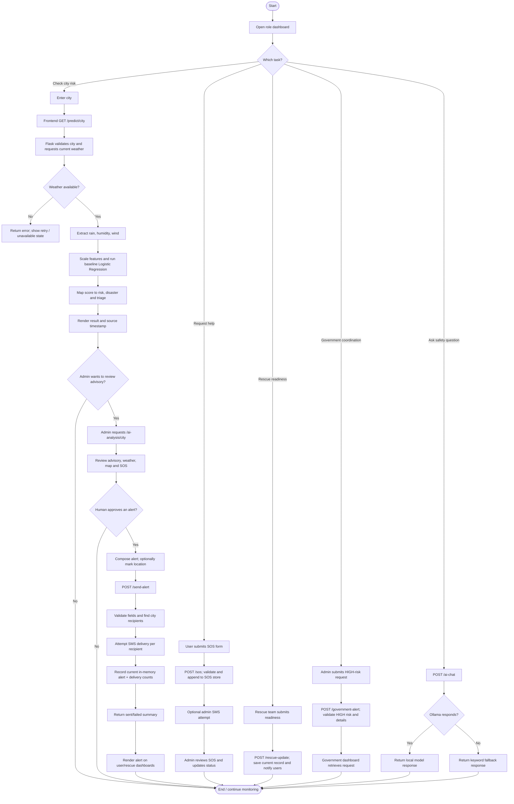
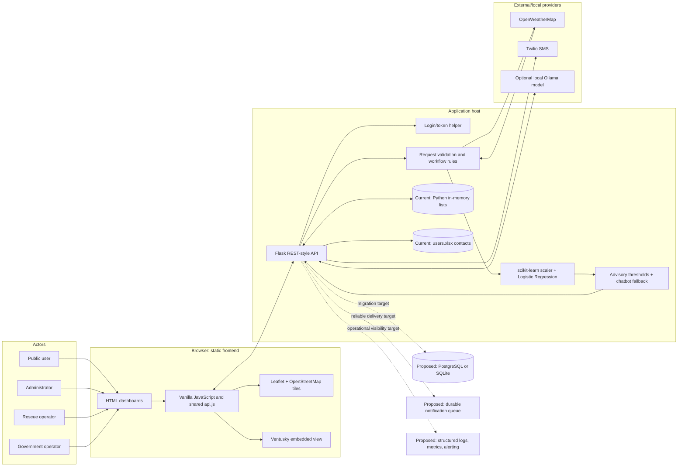
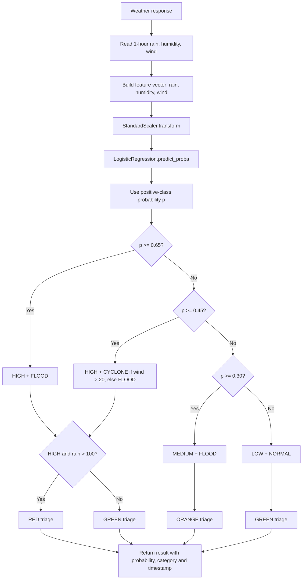

# GravityShift AI — End-to-End Workflow and System Design

> **Project objective:** Provide a role-based disaster-risk and emergency-coordination application. It combines weather observations with a small baseline risk classifier, supports user SOS requests and rescue/government coordination, and lets an administrator review information and manually issue public alerts.
>
> **Design principle:** This is a human-in-the-loop decision-support tool, not an autonomous emergency authority. The risk score and chatbot are advisory. An authorized human must verify conditions and explicitly send an alert.

## 1. Overall workflow in simple language

1. A user, administrator, rescue team, or government operator opens the appropriate dashboard.
2. A person enters a city, reports an emergency, submits team readiness, or creates a relief-resource request.
3. The browser sends the request to the Flask API. The API checks required fields and calls external services when needed.
4. For a city-risk check, the backend retrieves current weather and passes rainfall, humidity, and wind speed to a baseline Logistic Regression model. It returns the observation and a LOW/MEDIUM/HIGH risk assessment.
5. An administrator can request a separate advisory analysis, inspect the map and available reports, optionally place a location marker, and decide what action is appropriate.
6. Only when the administrator submits an alert does the backend look up users in that city and attempt to send SMS messages. The alert is then visible on supported dashboards.
7. Users can submit SOS requests. Administrators review them and update their status. Rescue teams submit readiness/deployment information, and government-facing requests are supported for HIGH-risk scenarios.
8. The dashboards show the response data. Failures such as an unavailable weather service, invalid input, or failed SMS delivery should be shown to the operator and handled without pretending the external action succeeded.

## 2. Scope and implementation status

The labels below distinguish the checked-in demo from recommended work; a file's presence does not mean a production capability is configured or operational.

| Capability | Current implementation | Recommended production evolution |
|---|---|---|
| Frontend | Static HTML, CSS, and browser JavaScript dashboards for user, admin, rescue, and government roles. | Keep the role workflows; add accessible form validation, explicit loading/empty/error states, and responsive test coverage. |
| API | Flask routes called with `fetch`; JSON request/response bodies. | Version the API, validate schemas centrally, rate-limit public routes, and add request IDs and structured logs. |
| Weather | `/predict/<city>` and `/ai-analysis/<city>` fetch current conditions from OpenWeatherMap. | Use configured secrets, explicit units/source timestamps, caching, provider timeouts/retries, and data-freshness checks. |
| Risk assessment | Scikit-learn `StandardScaler` and `LogisticRegression`, trained at application startup from a small, hard-coded example dataset. Inputs are rainfall, humidity, and wind. | Treat this as a demo baseline, not a validated forecast. Establish labeled historical data, independent evaluation, calibration, monitoring, and domain-expert approval before operational use. |
| Advisory analysis | Rule-based text based on weather thresholds plus the risk score. Admin workflow is intended to be advisory. | Preserve human approval; display source/freshness and limitations. Enforce role permissions on the server. |
| Chat assistance | `/ai-chat` calls local Ollama (`mistral:latest`) and falls back to keyword-based responses. | Keep it clearly labeled as informational; add safety-reviewed responses, bounded timeouts, privacy controls, and monitoring. Never use chatbot output as an alert trigger. |
| Alert delivery | `/send-alert` reads users from `users.xlsx`, attempts Twilio SMS, and adds the alert to a Python in-memory list. | Persist alert and per-recipient delivery records before/while sending; use a durable queue, retries with limits, idempotency, consent and opt-out handling, and delivery reconciliation. |
| SOS, rescue, government records | Python in-memory lists; records are lost when the process restarts. | Migrate to a relational database with transactions, audit history, retention policy, and backups. |
| Database | The current `app.py` stores operational alerts/SOS/rescue/government requests in process memory; user contacts come from an Excel file. A database file in the repository is not used by the routes described here. | Use PostgreSQL for a multi-user deployment; SQLite can be a simpler single-instance project upgrade. Do not treat Excel or process memory as a durable system of record. |
| Authentication | Login endpoints issue a lightweight token; frontend checks are present in shared API helpers. The current API routes do not consistently enforce role authorization server-side. | Add server-verified, expiring sessions/tokens and role/permission checks to every protected endpoint. Use secure password hashes and HTTPS. |
| Map and location | Leaflet/OpenStreetMap map; manual admin marker; Ventusky embedded view. A nearest LOW-risk configured district helper exists at `/safe-route`. | Validate coordinates and data freshness, integrate approved routing/authoritative hazard layers, and do not describe a nearest low-risk district as a verified safe route. |
| Notifications and monitoring | Twilio integration is a code path; credentials are placeholders in source. Basic API health route is `/api`; some failures print to console or use fallback behavior. | Configure credentials outside source, centralize logs/metrics, alert on service failures, and distinguish partial from complete delivery. |

**Operational caution:** The classifier's training examples are embedded in `backend/app.py`; the resulting probability is not a validated real-world probability. It uses current weather rather than forecast time-series or official hazard bulletins. This project must not be the sole basis for emergency decisions.

## 3. Detailed end-to-end workflow (the 10 requested stages)

| # / stage | What happens and responsible module | Input | Processing | Output | Connection to next stage |
|---|---|---|---|---|---|
| 1. User interaction and input collection | A person uses the relevant dashboard: city-risk check, SOS form, admin alert/analysis form, rescue readiness form, or government request form. | City; weather/risk query; contact and incident details; alert text/times/location; team/resources. | Browser collects fields, role context, and optional map coordinates. Required-field checks should run before submission; API also validates required fields. | User action and structured form values. | Dashboard JavaScript serializes the action as a URL/query or JSON API request. |
| 2. Frontend interface and dashboard | Static pages in `frontend/` (`index.html`, `user.html`, `admin.html`, `rescue.html`, `government.html`); shared helpers in `api.js`. | Form values, role/login state, and prior API responses. | `fetch` calls Flask; dashboard renders map, risk badges, lists, status, and response messages. Admin selects live/satellite map, can place a marker, and reviews advisory data. | API request; after response, rendered result or visible error/status. | API helper targets `http://127.0.0.1:5000`; user action determines the backend route. |
| 3. Backend API and business logic | Flask app in `backend/app.py`, with role-login helper in `backend/role_login.py`. | HTTP method/path, query parameters or JSON, and optional authorization header. | Route selection; required-field checks; city lookup, status update, risk computation, recipient selection, and workflow rules (for example, government request must be HIGH risk). | JSON success, validation, or error response. | Weather-dependent routes call the weather provider; event routes read/write current stores and may call SMS or Ollama. |
| 4. Data collection and validation | `fetch_weather`, request parsing/route validation, `load_users_by_city`, and configured district list. | City string, API JSON, user contacts from Excel, submitted incident/resource fields. | Weather provider response is checked for availability; fields are extracted. Current validation checks required fields for several POST routes. User phone numbers are normalized with an India `+91` prefix when no `+` is supplied. | Weather fields, matched recipients, or validated event object; on failure, an error/empty result. | Weather values go to the risk engine; validated user/event details go to storage and/or notification processing. |
| 5. Database storage and retrieval | **Current:** `alerts_store`, `sos_store`, `rescue_store`, and `gov_store` in memory; user contact lookup from `users.xlsx`. | Alert/SOS/rescue/government event objects and city filters. | Append/search/update Python lists; Excel is loaded and filtered by city for recipients. This is not durable storage and concurrent operations are not transaction-safe. | A record/list for API response or dashboard display; user rows for notification. | Stored/retrieved weather or event data feeds scoring, dashboards, status workflows, and alert delivery. |
| 6. Core algorithm or AI/ML processing | `compute_risk` applies `StandardScaler` and `LogisticRegression`; `/ai-analysis/<city>` adds weather-threshold advisory statements; `/ai-chat` uses Ollama with fallback. | Rainfall in mm (current 1-hour value when present), relative humidity (%), wind speed (m/s); or a chatbot query. | Scale the three numeric features; calculate positive-class model probability; map probability bands to risk/disaster/triage; calculate demo gravity/buoyancy display values. Advisory thresholds add text. Chat generates a short answer locally when Ollama is available, otherwise rule-matches the query. | Risk score fields, advisory text, or chatbot response. | Prediction is displayed for a user's check or given to an administrator for review; it does not itself dispatch an alert. |
| 7. Decision-making and optimization | Admin dashboard and authorized human operator. `/safe-route` is a separate helper; its logic compares configured districts whose current computed risk is LOW. | Weather/risk result, SOS queue, map marker, user-provided message, response capacity, and policy. | Human verifies context and chooses whether to alert, update SOS status, coordinate teams, submit a government request, or take no action. Safe-zone helper calculates haversine distance to candidate districts; it does not calculate road routes. | Explicit operator action, or an advisory nearest-district result / `no_safe_zone`. | Selected action is sent to the corresponding write API; no prediction automatically becomes a public warning. |
| 8. Results generation and visualization | Flask JSON responses and role dashboards; Leaflet map with OSM tiles, optional Ventusky embed, status panels and risk colors. | Prediction/event responses, alert lists, SOS/rescue/government lists, and coordinates. | Format data into JSON; filter alerts by city if requested; frontend renders cards/tables/badges/map markers and updates status views. | Risk result, alert, SOS/rescue/request status, or location display. | User sees results; admin/rescue/government dashboards refresh or request the corresponding collection endpoint. |
| 9. Alerts, notifications, and error handling | `/send-alert`, `send_sms`, `/sos`, `/rescue-update`, and `/ai-chat`; frontend shared API helpers and toast/error handling. | Admin-approved alert; recipient list; SOS or rescue event; chatbot query; external service response. | Alert route attempts one SMS per matched city recipient and returns sent/failed counts. SOS optionally notifies the configured admin number. Rescue update attempts to notify matching users. API returns 400 for missing required fields and 404 for missing weather/SOS; chatbot falls back if Ollama is unavailable. | Per-recipient delivery outcome and alert record; event acknowledgement; error JSON or fallback answer. | Delivery outcomes are shown to the operator; events are retrieved by dashboards. Production design should persist notification attempts and report partial failure distinctly. |
| 10. Admin monitoring and maintenance | Admin dashboard, `/api` health endpoint, application logs, configuration and deployment environment. | API health, dashboard activity, logs, service/provider status, delivery outcomes, database health (proposed). | Admin reviews alerts and SOS, updates statuses, coordinates rescue/government requests. Maintainers check logs, rotate credentials, back up storage, patch dependencies, and validate model/data quality. | Operational decisions, acknowledged issues, audited status changes, and service health. | Maintenance feedback informs configuration, fixes, retraining/revalidation, and the next operational cycle. |

### Primary API handoffs

- Risk lookup: `GET /predict/<city>` → current weather + risk result.
- Admin pre-alert advisory: `GET /ai-analysis/<city>` → weather-derived advisory. The current code documents this as admin-only, but backend route authorization must be added before relying on that boundary.
- Chat: `POST /ai-chat` with `{"query":"..."}`.
- Admin alert: `POST /send-alert`; user/rescue reads via `GET /alerts` (optionally `?city=<city>`).
- User SOS: `POST /sos`; admin reads `GET /sos-list` and updates with `POST /sos-update/<id>`.
- Rescue: `POST /rescue-update`; dashboards read `GET /rescue-list`.
- Government coordination: `POST /government-alert`; list via `GET /government-list`. Current logic accepts only `risk=HIGH`.
- Nearest low-risk configured district: `GET /safe-route?lat=<latitude>&lng=<longitude>`. This is a district-distance suggestion, not turn-by-turn directions.
- Health: `GET /api`.

## 4. Complete end-to-end flowchart



## 5. System architecture diagram



## 6. Frontend, backend, and database interaction diagram

```mermaid
sequenceDiagram
    actor Person as User/Admin/Rescue/Government
    participant UI as Role dashboard (HTML/JS)
    participant API as Flask API
    participant WX as Weather provider
    participant ML as Risk engine
    participant Store as Current lists / Excel
    participant SMS as Twilio
    participant DB as Proposed relational DB

    Person->>UI: Enter city or submit an action
    UI->>API: GET /predict/{city}
    API->>WX: Fetch current weather
    WX-->>API: Weather JSON or provider error
    API->>ML: rain, humidity, wind
    ML-->>API: probability, risk, triage, disaster
    API-->>UI: JSON result or HTTP error
    UI-->>Person: Render result / retry state

    Person->>UI: Admin explicitly submits alert
    UI->>API: POST /send-alert (JSON)
    API->>API: Validate fields and policy
    API->>Store: Read city contact rows; append alert
    Store-->>API: Contacts / in-memory record
    loop Each matched contact
      API->>SMS: Send alert SMS
      SMS-->>API: Accepted or failed
    end
    API-->>UI: Alert ID and sent/failed counts
    UI-->>Person: Show delivery summary

    Note over API,DB: Current operational records are process memory, not a durable database.
    API-. proposed transaction .->DB: Persist event and notification status
```

## 7. Detailed data flow diagram

```mermaid
flowchart LR
    P((Person)) -->|form values / city| FE[Dashboard forms]
    FE -->|HTTP JSON or GET| API[Flask routes]
    API -->|city request| WAPI[Weather provider]
    WAPI -->|temperature, rain, humidity, wind, coordinates| API
    API -->|rain, humidity, wind| MODEL[Scaler + Logistic Regression]
    MODEL -->|probability, risk category| API
    API -->|risk JSON| FE
    FE -->|risk badge / map / result| P

    P -->|SOS fields| FE
    FE -->|POST /sos| API
    API -->|append| SOS[(SOS in-memory list)]
    API -->|optional notification| SMS[Twilio]
    API -->|SOS acknowledgement| FE
    SOS -->|GET /sos-list| API
    API -->|SOS records| Admin[Admin dashboard]
    Admin -->|POST /sos-update/{id}| API
    API -->|status mutation| SOS

    Admin -->|approved alert fields| FE
    FE -->|POST /send-alert| API
    API -->|city filter| XLS[(users.xlsx)]
    XLS -->|matching phone numbers| API
    API -->|one message per recipient| SMS
    SMS -->|delivery attempt outcome| API
    API -->|append alert and counts| ALERTS[(Alerts in-memory list)]
    ALERTS -->|GET /alerts| API
    API -->|alert JSON| UserView[User/rescue dashboards]

    RescueForm[Rescue dashboard] -->|POST /rescue-update| API
    API -->|append| RESCUE[(Rescue in-memory list)]
    GovForm[Admin government request] -->|POST /government-alert| API
    API -->|HIGH-risk gate; append| GOV[(Government in-memory list)]
    GOV -->|GET /government-list| API
    API -. proposed replacement .-> DB[(Relational database)]
```

**Data minimization note:** SOS payloads include names, phone numbers, and addresses. A production version should restrict access, transmit only over HTTPS, define retention/deletion rules, and avoid exposing full phone-number lists in broad API responses.

## 8. Algorithm workflow

### 8.1 Current risk scoring



The code also computes display-only `gravity` and `buoyancy` values from simple formulas. These are not established disaster-science measurements. `/ai-analysis/<city>` adds threshold-based advisory phrases: rain over 100 mm (high flood chance), rain over 50 mm (moderate flood risk), wind over 20 m/s (cyclone conditions), wind over 12 m/s (strong wind advisory), and humidity over 85% with rain over 30 mm (possible landslide in hilly areas). These statements must be interpreted with current weather context, not as a forecast.

### 8.2 Recommended production decision path

1. Require complete provider data, units, observation time, and acceptable freshness.
2. Reject invalid/non-finite feature values; never silently replace missing provider data with reassuring values.
3. Run a versioned model only if input domain and model validation checks pass.
4. Return the score with its model version, data source/time, known uncertainty, and an explicit advisory label.
5. Let a trained human operator review official bulletins, local reports, and the risk output.
6. Require explicit confirmation for any external notification; preview target area, message, and recipients.
7. Persist the approved event and a durable notification job before sending; reconcile each provider result.
8. Provide a manual fallback procedure when weather, model, database, or SMS services are unavailable.

## 9. Exception handling and alternative workflows

| Condition | Current behavior / response | Safe operational handling and alternative |
|---|---|---|
| Unknown city, weather provider unavailable, or timeout | `fetch_weather` returns no usable result; prediction/advisory routes return a 404-style error. | Show “weather unavailable,” preserve user input, allow retry, and direct operators to official sources/manual procedures. Do not turn missing weather into a LOW-risk result. Add provider timeout and stale-data indicators. |
| Weather response missing rain | Code currently treats missing rain observation as 0 mm. | Distinguish “not reported” from measured zero in a production schema; annotate confidence/coverage and require operator review if critical inputs are absent. |
| Malformed/non-numeric weather fields | Current scoring assumes provider fields have usable numeric values; malformed values are not covered by a dedicated validation response. | Validate finite numeric values and units before scoring; return an explicit unavailable/invalid-input state rather than a risk classification. |
| Missing request fields | Relevant POST routes return HTTP 400 with missing-field information. | Highlight fields inline; validate types/ranges and lengths server-side; reject invalid coordinates and time windows. |
| No matched city contacts | Alert can still be added to the current alert list with zero attempted recipients. | Treat as a partial/failed delivery state, warn the admin before dispatch, offer alternate channels, and persist the recipient count and reason. |
| Some/all SMS sends fail | `send_sms` returns false for a failed call; alert response includes sent/failed counts. | Show partial success explicitly; retry transient errors through a bounded durable queue, prevent duplicate sends with idempotency keys, and provide an alternate official channel. Never label failed delivery as successful. |
| Twilio missing/unconfigured | SMS calls fail; current source uses placeholder Twilio values. | Keep SMS disabled until validated credentials, sender identity, destination policy, and a test send are configured. Keep manual phone/official channel procedures. |
| Ollama unavailable/slow | Connection failure uses rule-based chatbot fallback; other errors are logged and fallback is returned. | Label fallback/model source, enforce a short timeout, keep answers concise and safety-reviewed, and expose “not a substitute for official instructions.” |
| Invalid SOS ID or unknown record | `/sos-update/<id>` returns 404 if no matching item is found. | Keep status unchanged, show actionable message, and record the attempted update for audit where appropriate. |
| No configured low-risk district | `/safe-route` returns `status: no_safe_zone`. | Do not recommend travel. Present official emergency contacts and authoritative instructions; avoid describing this calculation as a road route. |
| Application restart | In-memory alerts, SOS, rescue, and government records are lost. | Current demo: disclose volatile state and keep test data non-critical. Production: persist records transactionally and test restore from backups. |
| Unauthorized access | Frontend login checks exist, but route-level role enforcement is incomplete in current backend. | Treat this as a release blocker for real personal data/alerts: enforce authorization server-side on every protected operation, use expiring credentials, and audit sensitive actions. |
| Database failure (proposed) | No operational database currently backs the event routes. | In the upgraded design, fail writes visibly, do not dispatch an alert whose approved event cannot be durably recorded, and provide recovery/reconciliation. |

## 10. Technology list

### Currently used or referenced

- **Frontend:** HTML5, CSS, vanilla JavaScript, browser Fetch API, `localStorage` for client-side login state.
- **Maps:** Leaflet, OpenStreetMap tiles, Ventusky embedded view.
- **Backend/API:** Python, Flask, Flask-CORS, JSON over HTTP.
- **Weather:** OpenWeatherMap current-weather API via `requests`.
- **ML/data:** NumPy, pandas, scikit-learn (`StandardScaler`, `LogisticRegression`), Excel via pandas/openpyxl.
- **Chat:** Optional local Ollama model endpoint; configured model name in current `app.py` is `mistral:latest`; keyword fallback.
- **Notifications:** Twilio Python SDK for SMS (requires valid configuration).
- **Current event store:** Python lists in the Flask process; contact spreadsheet `users.xlsx`.

### Recommended for a dependable deployment (proposed)

- **Persistence:** PostgreSQL (or SQLite for a single-instance academic demo), schema migrations, constraints, indexes, backups.
- **Authentication/authorization:** Secure password hashing, server-validated expiring sessions/JWT with role-based permissions, HTTPS, secrets manager/environment configuration.
- **Delivery reliability:** Background task queue (for example, Celery/RQ with Redis) or a managed queue; retries, idempotency, dead-letter review.
- **Quality and operations:** Automated unit/API/integration tests, structured logs, health/readiness checks, metrics, error reporting, dependency pinning, CI pipeline.
- **Safety governance:** Official hazard-data source review, model evaluation/calibration, human approval, message templates and audit trail.
- **Deployment:** Production WSGI server behind HTTPS reverse proxy; separate development/test/production configuration.

## 11. Step-by-step implementation plan

### Phase 1 — Make the current demo reproducible
1. Confirm role workflows, route contracts, and demo scenario with stakeholders.
2. Move API keys, passwords, and signing secrets out of source; rotate any credentials that have been exposed.
3. Add configuration validation and a clear health/readiness response.
4. Make API errors and external-provider failures visible in the relevant dashboard; add client-side loading and empty states.
5. Add unit tests for risk thresholds, request validation, SMS failure reporting, and `/safe-route` edge cases.

### Phase 2 — Secure access and protect data
1. Implement server-side authentication and role authorization for admin, rescue, government, and public operations.
2. Hash passwords, issue expiring sessions/tokens, protect secret material, enforce HTTPS, and add rate limiting to public endpoints.
3. Minimize PII in responses and logs; document access and data-retention policy.
4. Add audit records for alert approval, SOS status changes, and government requests.

### Phase 3 — Introduce durable persistence
1. Define relational entities: users/contacts, roles, weather observations, alerts, notification attempts, SOS cases, rescue teams/status updates, and government requests.
2. Add migrations, constraints, indexes, and repository/service-layer persistence.
3. Migrate reads/writes from process lists to transactions; retain a controlled import path for existing contact data.
4. Add backup/restore and restart-persistence integration tests.

### Phase 4 — Make alert delivery reliable
1. Validate target geography, recipient eligibility, message length, and delivery window.
2. Show a pre-send preview and recipient count; require explicit admin confirmation.
3. Persist the approved alert before dispatching a queued notification job.
4. Record each recipient's outcome, retry only transient failures, prevent duplicate delivery, and expose partial success.
5. Add delivery monitoring and a documented manual fallback.

### Phase 5 — Validate data and risk logic
1. Define whether risk means current-condition screening or future forecasting; choose trusted observations/forecast/bulletin sources accordingly.
2. Create a provenance-aware dataset with domain-validated labels and documented units.
3. Compare simple threshold baselines and ML models using temporal/region-based held-out evaluation.
4. Measure false negatives/positives, calibration, drift, and performance by region; get expert review.
5. Version the model and data pipeline; deploy only as advisory until authorized validation and governance are complete.

### Phase 6 — Test, deploy, and operate
1. Add frontend, API, persistence, and provider-mocked integration tests.
2. Run security, accessibility, load, recovery, and notification-failure exercises.
3. Deploy behind HTTPS with separate configuration and restricted database/network access.
4. Monitor API/provider availability, stale weather, queue depth, notification failures, and application errors.
5. Train operators, publish escalation procedures, and conduct periodic incident-response drills.

## 12. Illustrative real-world scenario: heavy rain in Chennai

This example demonstrates application behavior; its values are illustrative, not an actual forecast or emergency instruction.

1. **Check:** A user enters “Chennai” in the user dashboard. The browser calls `GET /predict/Chennai`.
2. **Collect:** Flask requests current weather from OpenWeatherMap. Suppose it returns rainfall of 120 mm for the relevant one-hour field, humidity 88%, and wind 15 m/s, plus temperature, description, coordinates, and observation context.
3. **Score:** The backend transforms `[120, 88, 15]` using the startup-fitted scaler and passes it to the demo logistic-regression model. It maps the model probability to a risk band and returns the values with a timestamp. This score is illustrative and not a validated operational forecast.
4. **Review:** An administrator runs `/ai-analysis/Chennai`, reviews its risk/advisory and raw weather values, compares them with authoritative reports, and optionally places a map marker. The prediction does not send anything automatically.
5. **Decide:** The administrator chooses to send a warning, writes and previews the message, defines its time window, and explicitly submits the alert.
6. **Dispatch:** `/send-alert` validates required fields, reads matching Chennai contacts from `users.xlsx`, and attempts one SMS per matching number using Twilio. In the current version, the alert and per-recipient results are held in process memory; configured valid Twilio credentials are required for actual delivery.
7. **Report:** The API returns the alert ID, number of matched users, SMS successes, and failures. The dashboards can retrieve the alert from `/alerts`. The admin reviews failed deliveries and follows the appropriate manual fallback.
8. **Respond to SOS:** A resident submits an SOS with contact, address, and incident details. The request enters the in-memory SOS list as `PENDING`; an administrator reviews it, coordinates a team, and updates it to `IN_PROGRESS` or `RESOLVED`.
9. **Coordinate:** A rescue team submits readiness/deployment information. If the situation is HIGH risk, an administrator may also send an accommodation or hospital request to the government dashboard.
10. **Close and learn:** Operators resolve cases and review outcomes. In the current demo, a backend restart clears event records; in the proposed production design, events and delivery history remain auditable and available for post-incident review.

## 13. Key design decisions and acceptance checks

- No public alert is sent by the prediction model, advisory rules, or chatbot; an explicit human action is required.
- Every weather-derived result should carry its source and freshness; missing/stale data must not be presented as confirmed safety.
- User-facing messages must not promise rescue or delivery unless the responsible service confirms it.
- The current ML output is a baseline demonstration only. A high probability is not automatically equivalent to a validated probability of a disaster.
- The current process-memory stores and source-level demo credentials are not production controls.
- Before real deployment, verify with tests that role permissions are enforced, approved alerts are persisted before dispatch, duplicate retries do not duplicate messages, partial SMS failures are visible, and operational data survives a restart.
